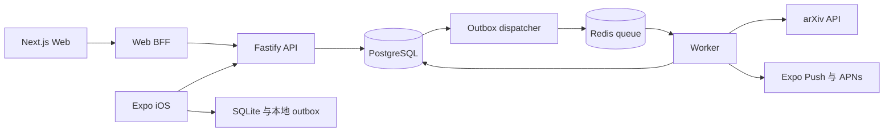

# PRISM MVP Technical Design

版本 1.1 · 2026-11-08 · 对应 PRD v1.0 · 状态 Implemented locally / deployment candidate

PRISM 首版采用两个客户端、一个模块化后端、统一 PostgreSQL 和独立 Worker。本文记录事务、数据归属、离线协议和调度规则；实现状态及尚待真实部署与设备验证的项目见[验收记录](../implementation/acceptance.md)。初始 Prisma 提案已由[SQL repository 决策](adr-001-sql-repositories.md)取代。

## 架构和工程边界

| 层       | 选择                                                           | 职责                                        |
| -------- | -------------------------------------------------------------- | ------------------------------------------- |
| Web      | Next.js、React、TypeScript、CSS、KaTeX                         | 数学编辑、研究与多窗格工作区                |
| iOS      | React Native、Expo development build、SQLite                   | 移动复习、训练、通知与离线录入              |
| API      | Fastify、TypeScript、共享 Core 与参数化 SQL repository         | 授权、校验、command handlers 与权威业务状态 |
| Database | PostgreSQL 16 或更高版本                                       | 产品事实、约束、同步批次与审计              |
| Worker   | 独立进程、Redis 与 BullMQ                                      | arXiv、digest、通知和导出                   |
| 共享包   | core、database、types、api-client、fsrs、planner、shared-utils | 可复用类型、业务与基础设施适配              |



apps/web、apps/mobile、apps/api、apps/worker 独立构建，放在同一 monorepo。REST 与 /sync/push 调用同一 Core command handler；Web 不直接访问数据库。纯 fsrs/planner 包不导入数据库、HTTP 或 UI。

Node.js 24 系列为后端初始兼容性基线。当前 ts-fsrs 官方文档区分软件包 v6 与模型 FSRS-7，并要求 Node.js 至少 24。Phase 0 验证后将所有精确依赖版本写入 lockfile；不把包版本当作模型版本。[ts-fsrs 官方仓库](https://github.com/open-spaced-repetition/ts-fsrs)

移动端复用 FSRS 适配器仅作预测。若上游库不兼容 Expo runtime，离线仍保存评分，显示“待服务器计算”；不得引入第二套未经验证的权威调度。

[Schema](../../database/schema.sql) 是数据库约束权威。受控 SQL migration 保留 RLS、CHECK、触发器、generated column 与部分索引，并保存初始迁移校验和；生产不使用 schema push 代替 migration。[OpenAPI](../api/openapi.json) 是客户端 HTTP 契约，采用 3.1.1 格式。[格式标准](https://spec.openapis.org/oas/v3.1.1.html)

## 认证和数据隔离

使用 OIDC Authorization Code + PKCE；部署设置 issuer、audience、Web/iOS client ID、redirect URI 和允许的唯一 subject。受控初始化命令建立 users、user_preferences、user_sync_state。无公开注册，不按客户端声明的 email 自动绑定账号。

iOS 使用系统浏览器登录，refresh token 保存在 SecureStore/Keychain。Web 使用 BFF，token 保留服务端会话，浏览器只有 Secure、HttpOnly、SameSite cookie；修改请求检查 Origin 和 CSRF。/auth/login、callback、logout 属于 Web 应用；refresh/revoke 使用 OIDC issuer 的真实端点。API 只接受经验证的 access token，校验签名、issuer、audience、expiry 和 allowlisted subject。

user_id 只从认证上下文派生。API 使用非表所有者、非 superuser、无 BYPASSRLS 的运行角色；每个数据库事务 SET LOCAL app.user_id，避免连接池泄漏上下文。所有用户表 FORCE ROW LEVEL SECURITY，跨用户关联另有复合外键。公开 arxiv 元数据 API 只有 SELECT 权限，Worker 才可更新。迁移角色与运行角色分开，不授予运行角色 DDL/TRUNCATE。

Markdown 禁止原始 HTML或进行白名单清洗；KaTeX trust=false。日志只记录 request/operation/job ID、状态与耗时，不能记录 token、完整数学内容或私人训练笔记。初版无外部 AI 数据处理。

## 数据生命周期

42 张表分为账户、知识、研究、任务和计划、训练、论文、同步及自动化。用户拥有的子表均带 user_id，并使用 (user_id,parent_id) 外键。研究任务另通过 (user_id,project_id,research_object_id) 验证对象归属本项目。

可变实体使用 version、updated_at、deleted_at；版本从 1 起。每次成功修改或软删除显式 version+1，SQL UPDATE 带 expected version。API 将 bigint version/revision 序列化为十进制字符串。

review_submissions、review_events、research_events、scheduler_configs、conflict_resolution_events、已提交 sync_change_batches 和 api_idempotency 是不可变记录，触发器拒绝 UPDATE/DELETE。sync_operations 的命令与 hash 永久保留；仅 blocked 状态可在依赖就绪后转终态，终态不可重算或更改结果。

| 删除操作                  | 必须保留                                                          |
| ------------------------- | ----------------------------------------------------------------- |
| Knowledge item            | 软删除卡片和活动关系，保留所有复习历史                            |
| Research project          | 软删除项目和对象、归档活动项目任务，保留 timeline、独立知识与论文 |
| Workout template/exercise | 历史 session 模板和动作名称快照                                   |
| Workout session           | 软删除会话与子记录，保留原事实，统计排除软删除                    |
| Plan/task source          | 保存 plan item 的标题与时长快照                                   |

普通 API DELETE 是软删除。数据库 FK 不允许硬删除父记录破坏历史；新关联还须检查目标未被软删除。账户最终清除是单独管理流程。review 批次以 daily_plan_review_cards 表关联，API 数组只是投影。

Knowledge verification 与研究 claim_status 独立。computationally_verified 要求 evidence_metadata.scope/result；proved 要求 proof_content 或 evidence_reference。证据字段仅表达记录完整性，系统不形式化认证证明。claim 修改与包含旧值、新值及证据引用的 research_event 同事务；task 完成不能改变 claim。

## HTTP 与事务约定

路径前缀 /api/v1；JSON 使用 snake_case。instant 为 UTC ISO 8601，日期 YYYY-MM-DD，偏好时间 HH:mm。错误返回 error.code、message、details、request_id。普通列表使用绑定用户、过滤条件、排序与最后 (sort_key,id) 的签名 cursor，默认 50、最大 500。

所有可重试 mutation 使用 UUID Idempotency-Key；对验证后的身份范围、方法、规范化路径与 command payload 计算 SHA-256。同键同命令返回原状态码和结果，同键不同内容返回 409。直接 review 的 header key 等于 body idempotency_key；sync batch key 与每条 client_operation_id 独立。

PATCH、DELETE 与更新动作使用 If-Match: "version"。缺失返回 428，版本不符返回 412。review 使用 base_version，陈旧评分被保存为冲突后返回 409。已完成 task 的 complete 特例返回原完成时间，不追加重复事件。

所有产品写入固定锁顺序：

```
BEGIN
 SET LOCAL app.user_id
 SELECT user_sync_state FOR UPDATE
 检查永久 command receipt 和 hash
 按稳定 UUID 顺序锁定目标
 校验 ownership、version、生命周期和数据
 写入业务状态及不可变事件
 事务性增加 revision
 保存一条完整 sync_change_batches
 保存 receipt 与 outbox
COMMIT
提交成功后才返回 applied
```

同用户的所有写入，包括 Worker，都先锁 user_sync_state；revision 来自事务性行计数器，不能用 BIGSERIAL 分配顺序当作提交水位。业务、counter 和 batch 同时提交，防止迟提交的低序号被游标跳过。网络调用、抓论文和打包导出都在锁外。

REST 与 sync 使用统一去重命名空间：sync_operations 保存可离线 command 的永久结果，api_idempotency 保存 HTTP 封套，两者同事务写入。在线操作转入离线重试时沿用原 ID，不重新执行。

## FSRS 复习事务

默认 retention=0.90，MVP 禁用 fuzz。scheduler_configs 保存精确 library/model/adapter version、参数和 retention；卡片保留完整可序列化 fsrs_state。retrievability 在指定时刻计算，响应带 computed_at。模型升级不能隐式改写现有 due_at。

一次评分：

1. 保存原始 submission、设备、baseline、时间、duration、payload/hash。
2. 检查卡片归属、未删除/暂停、依赖已应用且 baseline 有效。
3. 若 reviewed_at 晚于 server now 五分钟、早于创建或上一 canonical review，保存 clock conflict；不悄悄夹取时间。
4. 用服务端状态、有效 reviewed_at 和固定配置运行适配器。
5. 插入唯一 immutable event，保存 previous/resulting state、配置与 card version 前后值。
6. 更新对应卡片和 due_at，写 receipt、sync batch 并提交。

有效离线评分使用原 reviewed_at，另存 effective_at；过旧本身不是丢弃理由，结果仍然 overdue 是允许情况。duration 来自 monotonic timer，独立校验。

两个设备基于同一版本评分时，第一条 applied；第二条保留 submission/conflict，不创建第二个 canonical event。UI 显示“已保留，尚未影响调度”。review 冲突只允许 keep_server/review_again；后者要求用户重新回忆并使用新操作 ID 评分，禁止自动把旧评分插入历史。

同一 theorem 的 statement/proof 卡片独立；复习一张不修改另一张。先 prompt，再 reveal，再四档评分；会话汇总按本次 operation ID 与历史计算数量、分布、用时、relearning 和下次到期。重试旧 receipt 不得覆盖客户端已拉取的新版本卡片。

## 离线与同步

SQLite 同事务保存本地更改和 outbox 后显示“已保存到设备”，服务端 applied 后显示“已同步”。local canonical 与 provisional 分开。实体与 operation 均使用稳定客户端 UUID。

OpenAPI 的 SyncOperation 判别联合列出支持的离线命令：知识创建/更新/删除、评分、任务创建/更新/完成、Inbox capture，以及训练 session/实际动作/组/cardio 的录入。其余操作在线使用 REST，不声称所有编辑都支持离线。

操作携带 base_version。可选 depends_on_operation_id 表达 session.create → exercise.create → set.create → session.complete；同实体连续操作可使用前一 applied 结果版本作为 baseline，跨实体依赖仅提供顺序。

push 每批最多 100 项/1MiB，逐项事务，按依赖拓扑处理；HTTP 200 不代表所有命令成功。结果为 applied、duplicate、conflict、rejected、blocked。未知/未就绪依赖 blocked 可重试；其余终态 receipt 永久复用。父操作冲突时保留整条离线链，由用户显式 rebase 为新命令，不能后台换 ID 重试覆盖。

知识与研究内容更新携带 base_snapshot，仅作为原始编辑基线保留；权威状态来自数据库。版本冲突保留 base/client/server 三份内容。keep_server、apply_client、merged 都检查目标当前版本；merged_payload 按原 patch schema 校验。解决操作追加不可变 audit，不改原 command。编辑已删除实体形成冲突，不隐式复活。

Workout 采用 set 级版本保护，不同组的修改可独立成功，同组并发形成冲突。新增子记录检查 parent 生命周期，完成 session 后允许修正组，更新投影版本并重算统计。

pull 按 revision 返回完整事务批次，客户端在一次 SQLite 事务中应用并更新 cursor；重放安全，旧 version 不覆盖新副本。快照在 REPEATABLE READ 中同时取得产品数据和 revision R，物化为不可变 records，固定分页；完整导入后从 R pull。快照有效 24h，创建快照不增加产品 revision。

增量与 tombstone 至少保留 90 天。cursor 绑定用户、schema、同步流代际、revision 与期限，跨用户拒绝，过期返回 410 后重新 bootstrap。数据库恢复后通过受控 after-restore 命令轮换流代际；旧 cursor 或旧 snapshot 返回明确的 410 恢复条件。移动端先持久化设备恢复副本和未同步 outbox、baseline 与冲突，再重新快照；已获确认但不在恢复点中的历史评分保留供人工核对，不盲目重放。设备密钥、OIDC subject、token、作业内部 payload 不在产品副本中。

## 训练和论文

训练开始时保存模板快照；实际动作有自己的顺序和名称快照。set 通过 composite FK 归属同用户、session 和 exercise。entered_weight/unit 保留输入，weight_kg generated column 使用 1 lb=0.45359237 kg。bodyweight 的未知外部负重为 null；completed set reps>0。

volume 只累计未删除、已完成且适用组的 kg×reps，null 外部重量不参与；比较限制相同 exercise_id，独立展示 cardio 时长和距离，不把 volume 当作普遍训练质量。session 完成仅在用户明确 complete_planned_task=true 时完成关联 task。

arXiv Worker 校验 Atom、兼容旧/新 ID、分离 version 后缀，upsert canonical paper 与唯一 version snapshot，latest_version 不倒退。抓取按更新时间使用七天重叠窗口，完整分页成功后推进 checkpoint。XML 禁用 DTD/外部实体，设置超时和尺寸上限，失败项隔离并记录。

arXiv legacy API/RSS 所有受控机器合计每三秒最多一次、单连接；使用共享限流器、应用 User-Agent 和有界退避。保存元数据并链接源站，不镜像 PDF。[arXiv 条款](https://info.arxiv.org/help/api/tou.html)；[Atom 与版本字段](https://info.arxiv.org/help/api/user-manual.html)

ranking-v1：类别精确匹配 4×weight，keyword/topic 在规范化标题/摘要中匹配 2×weight，作者规范化完整姓名匹配 6×weight，每条订阅只计一次；保存匹配原因。按 score、updated_at、arxiv_id 稳定排序。至少一条 enabled 订阅命中才进入 feed。收藏与阅读状态独立，每天一个合并 digest；同论文至多一个未完成阅读任务。

## 每日规划

planner-v1 输入明确 plan_date、timezone、as_of、capacity、实体及版本、review limit 和手动覆盖。标准化快照 hash 保存在 daily_plan；相同快照及版本保证相同结果。

1. 保留 completed、手动顺序、pin、skip/deferral，除非 override_manual=true。
2. 候选 task 只含 ready/in_progress，未来 planned_date 不提前；hard deadline 和用户 pin 作为可解释例外。
3. review 按 due_at/card ID 排序，限制 daily_review_limit 与 min(30分钟,capacity的25%向下取整)，初始每卡1分钟，其余保留在 queue。
4. 当天 hard deadline 与 pin 计入 required workload；合计超容量时显示 overload_minutes，不伪造可行日程。
5. 其余按 hard deadline、pin、overdue review、urgency bucket、priority降序、project importance降序、due_at、duration、UUID 排序。urgency bucket 为 overdue/今天/七天内/其余，默认优先级与项目重要性3。
6. 普通 task 不拆分，放不下则 defer 并继续尝试较短任务，每项有 reason。零容量同样返回完整可读方案。
7. 完成后 capacity 减 actual_minutes，缺省减 scheduled_minutes；保留已完成事实并重算剩余。

手工重排不改 deadline；skip 仅影响当天，reschedule 只有显式 due_at 才改变截止时间。deferred 永远可检索。今日 forecast 为 next local midnight 前到期，due_now 为此刻到期，开始复习只提供 due_now；较晚卡片显示 next_available_at。日期区间按相邻当地午夜转换 UTC，不能加固定24h。改变 timezone 不改历史 instant 或既有 FSRS due_at。

## 自动化与导出

业务事务写 outbox 后提交，dispatcher 租约领取并投递 Redis，投递失败可重试；投递与标记之间崩溃可能重复，消费者以 unique dedupe key 去重。Worker 使用 heartbeat/lease，最多5次，最后 dead，保留日志。评分调度始终事务同步执行，不能确认后再异步计算。

digest/planning/shutdown 通知 key 含 user、local date、job type 和配置版本。quiet hours 支持跨午夜，相同起止表示全天不 push；发送前再校验偏好。DST 不存在时间取下一有效 instant，重复时间只触发一次。外部 push 不承诺 exactly once，客户端以 notification ID 去重显示。

导出 Worker 使用一致快照，私有 ZIP 包含版本化 JSON、知识与研究 Markdown、manifest、counts 和 SHA-256。覆盖用户创建的产品数据、关联、复习及研究历史、软删除、计划、训练、订阅与冲突，附相关 arXiv metadata；排除凭据和内部缓存。ready 只在文件完成后设置，下载校验所有权，默认24h过期。导出不是数据库备份。

每日加密备份，初始 RPO目标24h、RTO目标4h，支持时启用PITR。上线前在隔离库真实恢复，检查版本、记录数和关键历史、评分去重及同步，再重建可重放作业。99.5% availability、P95<500ms 是待验证目标。

## 开发与发布验收

| 阶段       | 闭环                                  | 核心检查                                       |
| ---------- | ------------------------------------- | ---------------------------------------------- |
| Foundation | Web/iOS、OIDC、Schema、API client、CI | 同后端读写、RLS、跨用户拒绝                    |
| Knowledge  | 数学编辑、FSRS、历史、离线            | 独立卡、四档 fixture、重复请求、冲突与崩溃     |
| Research   | 项目、对象、证据、task、timeline      | 状态审计保留，task不认证claim                  |
| Fitness    | 模板、训练、cardio、历史              | 离线完整训练、无重复、单位换算、事后修正       |
| Discover   | 抓取、版本、订阅、保存和reading task  | 重复抓取、坏元数据、重试、已读与收藏并存       |
| Today      | 聚合、容量、手动覆盖、shutdown        | 确定性、超载、零容量、DST与deadline不变        |
| Beta       | 推送、导出、性能、恢复、TestFlight    | P0 E2E、真实PostgreSQL并发、恢复演练、两周使用 |

[初始校验记录](../validation.md)覆盖工程规格；[实现验收](../implementation/acceptance.md)及 verification 目录记录实际 FSRS handler、真实 PostgreSQL 多连接事务、客户端离线同步、浏览器闭环与本地备份恢复结果。这些检查不能替代真机与连续两周使用验收。任何评分丢失/重复调度、离线训练丢失、跨用户读取、研究审计覆盖、论文失控重复或恢复失败都会阻断正式发布。
